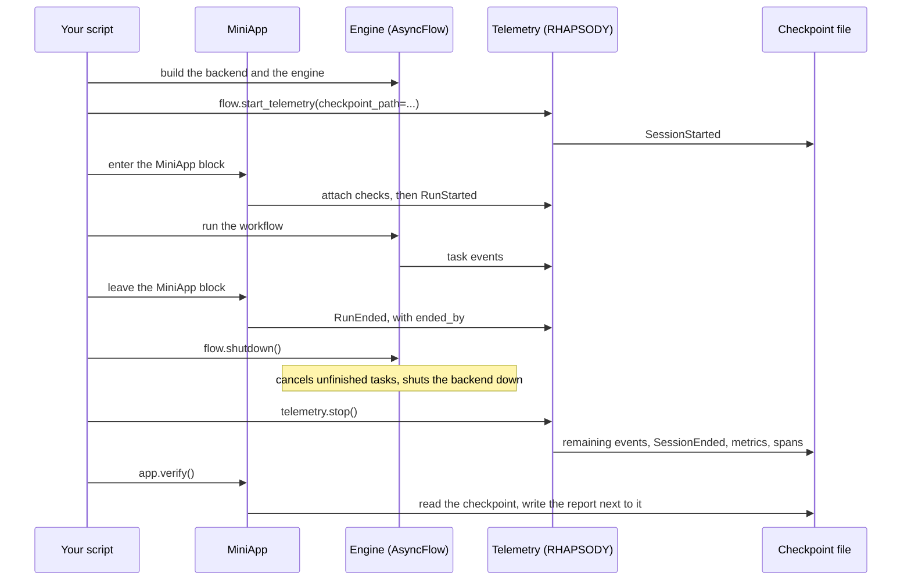
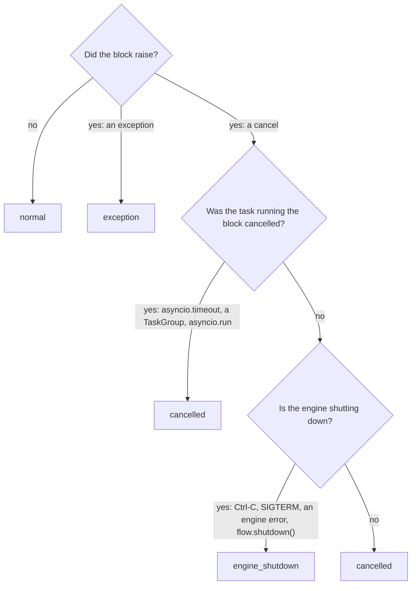

# Use MiniApp

This page shows how to attach `MiniApp` to a mini-app's script, and what `MiniApp`
does during a run. For what the run records, see [Telemetry](../telemetry.md).

`MiniApp` records each run of a mini-app and, at the end, checks that the run's
telemetry is complete. `MiniApp` attaches to the engine and the telemetry that your script
builds; it never builds, replaces or shuts down any of them.

## Who does what

| Part | Its role in a run | Documentation |
|---|---|---|
| **Your script** | Builds the backend, the engine and the telemetry; runs the workflow inside the `MiniApp` block; shuts everything down and calls `app.verify()` | This page |
| **`MiniApp`** (wfMiniAPI) | Checks the telemetry when the block starts, records when the run started and how it ended, verifies the checkpoint, writes the report | This page and [Telemetry](../telemetry.md) |
| **AsyncFlow** | The workflow engine (`flow`): runs the tasks in dependency order, emits their events, handles Ctrl-C | [AsyncFlow docs](https://radical-cybertools.github.io/radical.asyncflow/) |
| **RHAPSODY** | The execution backend, which runs the task bodies, and the telemetry manager, which writes the checkpoint file | [RHAPSODY docs](https://radical-cybertools.github.io/rhapsody/) |

## The script

Every mini-app script has this shape. Only the backend, the scope name and the
workflow change from one mini-app to the next.

```python
from radical.asyncflow import WorkflowEngine
from rhapsody.backends import DragonExecutionBackend
from wfMiniAPI.api import MiniApp

backend   = await DragonExecutionBackend()                        # (1)!
flow      = await WorkflowEngine.create(backend=backend)
telemetry = await flow.start_telemetry(checkpoint_path="telemetry")  # (2)!
app = MiniApp(flow, telemetry)
try:
    async with app, flow.workflow_scope("motif_4"):              # (3)!
        await miniapp_workflow(cfg, flow, logger)                 # (4)!
finally:
    try:
        await flow.shutdown()                                     # (5)!
    finally:
        await telemetry.stop()                                    # (6)!
        app.verify()                                              # (7)!
print(app.report.telemetry_complete, app.report.tasks)
```

1. Any RHAPSODY backend works. `ConcurrentExecutionBackend()` runs on a laptop; see
   [Getting started](../getting-started.md).
2. `checkpoint_path` is required: `MiniApp` verifies the file written there.
3. The *MiniApp block*. `flow.workflow_scope(...)` groups the run's tasks under this
   name in the telemetry.
4. Your workflow, unchanged. The workflow does not shut the engine down.
5. Your script shuts the engine down: unfinished tasks are cancelled and the backend
   stops.
6. Your script stops telemetry: everything still queued is written and the file is
   closed.
7. `MiniApp` reads the closed file, sets `app.report` and writes the report file. It
   never raises.

The order of the three calls in `finally` matters. The engine shuts down first, so its
last task events are emitted. Telemetry stops next, so all of them reach the file.
`app.verify()` comes last and reads the finished file.

### Why the `finally` is nested

If `flow.shutdown()` raises, for example because a backend fails to shut down, the
inner `finally` still stops telemetry and writes the report, and then the error
propagates. With a single, flat `finally`, that error would skip `telemetry.stop()`
and `app.verify()`: the checkpoint would stay open, there would be no report, and on
Dragon the process might not exit.

??? note "Works whether or not `flow.shutdown()` stops telemetry itself"
    With the pinned AsyncFlow, `flow.shutdown()` leaves telemetry running and your
    script stops it. If a future AsyncFlow stops telemetry inside `shutdown()`, this
    script still works: `telemetry.stop()` then does nothing, and the report gets a
    note saying that `RunEnded` could not be written. Keep your own `telemetry`
    variable rather than reading `flow.telemetry` in the `finally`.

## What MiniApp does during a run



### When the MiniApp block starts

`MiniApp` first checks that it can verify this run. `MiniApp` raises `AttachError` with a
message that says what to change when, for example, `telemetry` is not the object
`flow.start_telemetry()` returned, telemetry has no `checkpoint_path`, or tasks were
already submitted. [Troubleshooting](../troubleshooting.md#attacherror-when-the-miniapp-block-starts)
lists every case.

`MiniApp` then subscribes to telemetry, sends a `wfminiapi.Barrier` marker and waits
until telemetry has processed it (at most 30 seconds), which shows that telemetry is
running. Finally `MiniApp` records `wfminiapi.RunStarted`, with the versions of
wfMiniAPI, AsyncFlow and RHAPSODY and the backend classes.

Your script's `finally` handles an `AttachError` like any other error: it shuts the
engine down and stops telemetry, and `app.verify()` returns a report that says
`MiniApp` did not attach.

### When the MiniApp block ends

`MiniApp` records how the block ended (`ended_by`, below) and queues
`wfminiapi.RunEnded`. That is all: `MiniApp` awaits nothing, so a cancel cannot
interrupt it, and it never replaces the workflow's own exception. Shutting down is
left to your script, which does it next.

Because `RunEnded` is queued before the engine shuts down, the shutdown's own events
come after it in the file, and its `duration_s` covers the block only.

### How `ended_by` is decided



A workflow that catches the cancel and returns normally ends `normal`, even after
Ctrl-C.

### When your script calls `app.verify()`

`MiniApp` reads the checkpoint, sets `app.report`, writes
`<checkpoint_path>/<session>.wfminiapi.report.json` and logs one summary line. The
report's fields are described in [Telemetry](../telemetry.md#the-report).
`app.verify()` never raises: anything that goes wrong becomes a reason in the report.

??? note "If `app.verify()` is called too early, or never"
    - Called while telemetry still runs, `app.verify()` returns an incomplete report
      that says so and counts nothing; call it again after `telemetry.stop()`.
    - If a script never calls `app.verify()`, a warning is printed when the Python
      process exits: `verify() was never called; no report written`.

## Ctrl-C, signals and time limits

**Ctrl-C and SIGTERM** are handled by AsyncFlow, not by `MiniApp`
([AsyncFlow docs](https://radical-cybertools.github.io/radical.asyncflow/)). AsyncFlow
starts the engine's shutdown and cancels what the workflow is waiting for, so the
`MiniApp` block ends with `ended_by` = `engine_shutdown`. Your script's
`await flow.shutdown()` then waits for that same shutdown instead of starting a second
one. Tasks still running at that moment are cancelled without an end event; the report
counts them as `abandoned`.

**Time limits.** `MiniApp` sets none. An `asyncio.timeout()` around the `MiniApp` block
bounds the workflow, and your script's `finally` still runs after it. For a hard limit,
use one at the process level, such as the batch job's walltime or `timeout -k`. After
killing a run on Dragon, clean up as described in [Run on HPC](../hpc.md).

## Options

`MiniApp(flow, telemetry, *, backends=None)`

| Argument | Meaning |
|---|---|
| `flow` | The engine (`WorkflowEngine`). |
| `telemetry` | The telemetry manager that `flow.start_telemetry()` returned, called right before. |
| `backends` | The backends listed in `RunStarted`. Defaults to the engine's backend; pass them all if the engine has several. |

The full API is in the [API reference](reference.md).
