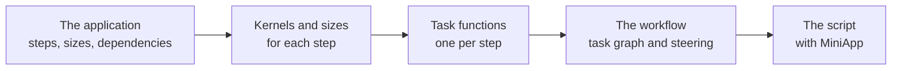

# Write the workflow

This page shows how to turn a real application's workflow into a mini-app: a workflow
with the same shape whose tasks run emulation kernels instead of the application.

A mini-app keeps what matters for the workflow system (how many tasks, how they depend
on each other, how much they compute, read, write and move) and drops the scientific
code. A mini-app runs anywhere wfMiniAPI installs and needs no application data.



## 1. Describe the application's steps

For each kind of step in the application, write down:

- what it does: computation, file I/O, communication, host/GPU data movement;
- how big: matrix or array sizes, bytes read and written, iterations;
- where it runs: CPU or GPU, one process or MPI ranks;
- what it needs first: which other steps must finish before it starts;
- how many run, and whether the next steps depend on its results (steering).

## 2. Choose kernels for each step

Each step becomes a short sequence of kernels with sizes that match the application.
For example:

| Application step | Kernels |
|---|---|
| a simulation time step | `generateRandomNumber`, then `matMulSimple2D` per step |
| writing or reading results | `writeNonMPI` / `readNonMPI`, or `writeWithMPI` / `readWithMPI` for MPI ranks |
| moving data to and from the GPU | `dataCopyH2D`, `dataCopyD2H` |
| a training step | `matMulSimple2D` on `"gpu"` |
| a collective between MPI ranks | `MPIallReduce`, `MPIallGather` |
| a fixed wait | `sleep` |

[Kernels](kernels.md) lists every kernel and what it stands in for. Keep the sizes in a
configuration file, so one mini-app can emulate small and large runs. The examples use
a `config.yaml` like this one from motif_3:

```yaml
simulate:
  steps: 8
  device: "cpu"
  read_size_bytes: 4294967296
  write_size_bytes: 1073741824
  matmul_dim: 8192
```

## 3. Write one task function per step

A task function runs the step's kernels with the configured sizes. The backend runs
task functions on its workers, so a task imports kernels from `wfMiniAPI.kernel` only:

```python
import random

from wfMiniAPI import kernel as kern

async def miniapp_workflow(cfg, flow, logger):

    @flow.function_task
    async def simulate():
        e = cfg["simulate"]
        kern.generateRandomNumber(device=e["device"], size=e["matmul_dim"])
        for _ in range(e["steps"]):
            kern.matMulSimple2D(device=e["device"], size=e["matmul_dim"])
        kern.writeNonMPI(num_bytes=e["write_size_bytes"], data_root_dir="./")
        kern.readNonMPI(num_bytes=e["read_size_bytes"], data_root_dir="./")
        return random.random()
```

`@flow.function_task` turns the function into a task of the AsyncFlow engine. Tasks can
also run executables or MPI programs; see
[AsyncFlow workflows](https://radical-cybertools.github.io/radical.asyncflow/async_workflows/).

## 4. Connect the tasks

Two ways of ordering tasks appear in every example:

- **A dependency.** Pass one task's result to another task: the engine starts the second
  task only after the first finishes. `train(simulate())` runs `simulate`, then `train`.
- **A wait in the workflow.** `await` a task, or `asyncio.gather()` several, when the
  workflow needs their results to decide what to run next, as the steering mini-apps
  do.

```python
sims = [simulate() for _ in range(4)]   # four tasks, run in parallel
await asyncio.gather(*sims)             # the workflow waits for all of them
scores = await analyze()                # then reads a result to steer
```

The task graphs of the examples, with both kinds of edge, are on
[Examples](examples.md). Blocks, task options and executable tasks are AsyncFlow
features; see the [AsyncFlow docs](https://radical-cybertools.github.io/radical.asyncflow/).

## 5. Run it with MiniApp

Keep the workflow in its own function, `miniapp_workflow(cfg, flow, logger)` in the
examples, and call it from the script shown in [Use MiniApp](api/miniapp.md). The
workflow never shuts the engine down: the script does that in its `finally`.

To run on a laptop, use `ConcurrentExecutionBackend()` and CPU kernels, as in the
[Quick start](getting-started.md#quick-start). To run on an HPC node, see
[Run on HPC](hpc.md).
