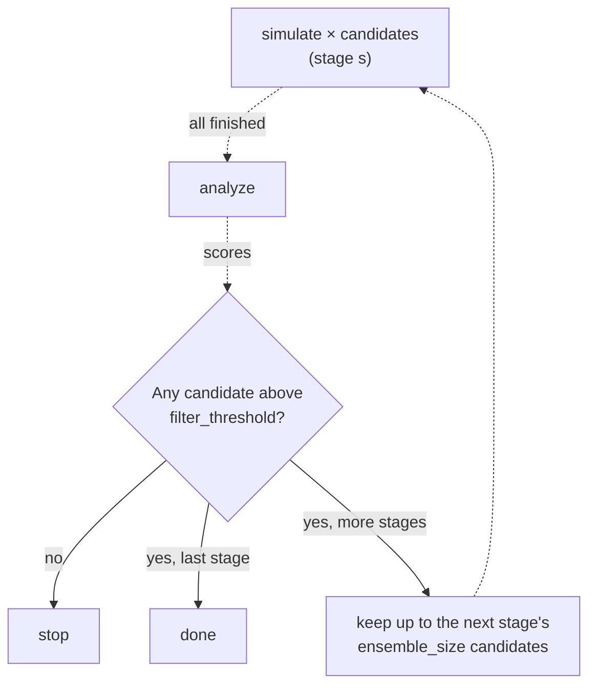
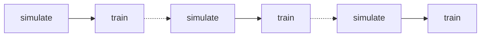
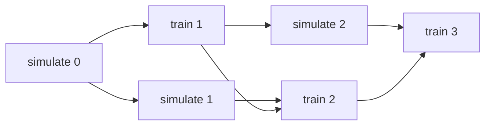
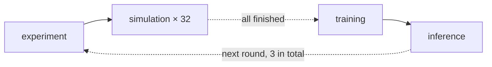
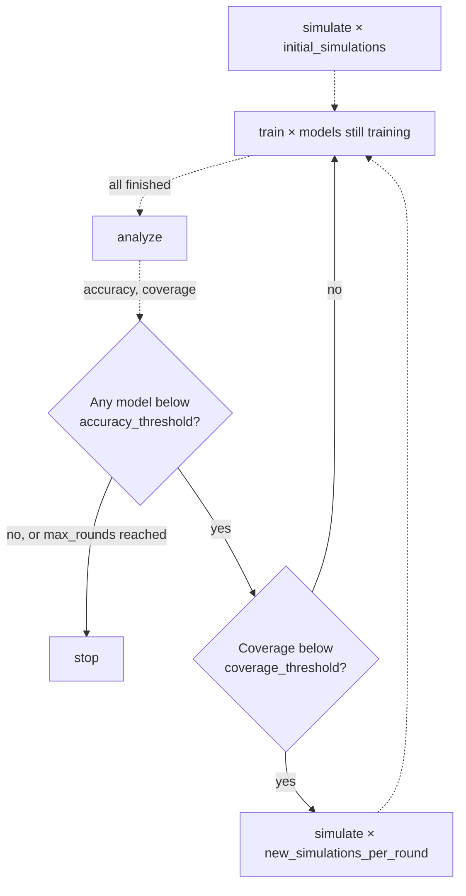
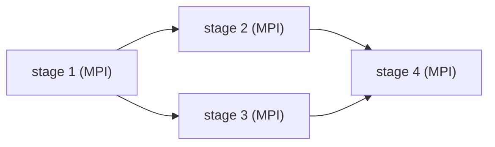
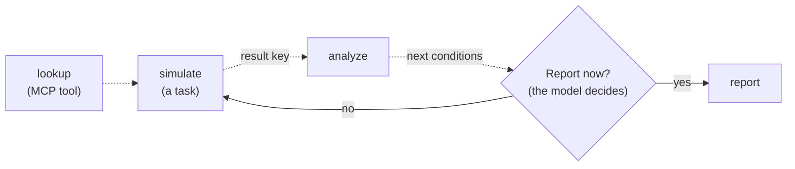

# Examples

This page describes the mini-apps in `examples/`: what each one emulates, its task
graph, and how to run it. Each example's README has notes from earlier runs; for the
install, follow [Run on HPC](hpc.md).

All of them use the [MiniApp script](api/miniapp.md#the-script). The workflow examples
keep their sizes in `config.yaml` and run under Dragon with GPU kernels in some tasks; see
[Run on HPC](hpc.md). agentic-screening takes flags instead, and runs on a laptop too. To try MiniApp on a laptop first, use the
[Quick start](getting-started.md#quick-start).

**Reading the graphs.** A solid arrow is a dependency: the engine starts the second task
when the first one finishes. A dashed arrow is a wait in the workflow: the workflow
awaits the first tasks, then creates the next ones, often based on their results.

| Example | Emulates | Tasks per run |
|---|---|---|
| [motif_2](#motif_2-multistage-pipeline) | a multistage screening pipeline | varies |
| [motif_3](#motif_3-inverse-design) | inverse design | 6 |
| [motif_4](#motif_4-digital-replica) | a digital replica | 105 |
| [motif_6](#motif_6-adaptive-training) | adaptive training (hyperparameter search) | varies |
| [dragon-mpi](#dragon-mpi-mpi-tasks) | a pipeline of MPI tasks | 4 |
| [agentic-screening](#agentic-screening-a-campaign-of-agents) | a materials-screening campaign of AI agents | varies |

## motif_2: multistage pipeline

`examples/motif_2/miniapp_pipeline.py`, scope `motif_2`. A sequence of simulation stages,
in the style of a high-throughput virtual screening pipeline. After each stage, an
analysis task scores the candidates, and only those above the stage's
`filter_threshold` go on to the next, smaller stage. The scores are random, so the
number of tasks varies from run to run.



```shell
cd examples/motif_2 && dragon -s miniapp_pipeline.py
```

!!! warning "Needs an input file in a fresh directory"
    Every `simulate` task reads `./data_0.h5` before writing it, so in a directory
    without that file the first stage fails. Create one before the first run:

        python -c "from wfMiniAPI import kernel as k; k.writeNonMPI(1048576, './')"

    Its tasks also share that file, like those of
    [motif_4](#motif_4-digital-replica), and can fail at random under Dragon for the
    same reason.

## motif_3: inverse design

Two variants of an inverse-design loop, each with three `simulate` and three `train`
tasks.

**`miniapp_simple.py`** (scope `motif_3_simple`): three rounds of simulate, then train.



**`miniapp_parallel.py`** (scope `motif_3_parallel`): the same six tasks, overlapped
through dependencies only.



```shell
cd examples/motif_3 && dragon -s miniapp_simple.py     # or miniapp_parallel.py
```

## motif_4: digital replica

`examples/motif_4/miniapp_async.py`, scope `motif_4`. Three rounds: an experiment
produces data, 32 simulations use it, then a model is trained and used for inference.
Each round has 35 tasks; the run has 105.



```shell
cd examples/motif_4 && dragon -s miniapp_async.py
```

!!! warning "Tasks can fail at random on the shared HDF5 file"
    All tasks read and write `./data_0.h5`. Under Dragon the 32 simulations run at the
    same time, and simulation 0 writes the file while the others read it. HDF5 locks
    the file while it is open, so a task can fail at random with a file-lock error,
    and the report counts it as `failed`. Setting `HDF5_USE_FILE_LOCKING=FALSE` before
    the launch avoids the lock error, but then a task can read a half-written file.

## motif_6: adaptive training

`examples/motif_6/miniapp_adaptive.py`, scope `motif_6`. Training as a workflow of its
own, in the style of a hyperparameter search. Simulations produce training data, then an
ensemble of models is trained in rounds. After each round, an analysis task scores the
models and the data: models below `accuracy_threshold` are retrained with new
hyperparameters, and new simulations run when the data coverage is too low. The run
stops when every model passes or after `max_rounds`. The scores are random, so the
number of tasks varies from run to run.



```shell
cd examples/motif_6 && dragon -s miniapp_adaptive.py
```

## dragon-mpi: MPI tasks

`examples/dragon-mpi/miniapp_rhapsody.py`, scope `dragon_mpi`. Four MPI tasks in a
diamond; each one runs with the number of ranks set in `config.yaml` and does MPI file
I/O. Before the first task, the workflow writes a small input file.



```shell
cd examples/dragon-mpi && dragon miniapp_rhapsody.py
```

This example needs an MPI library and `h5py` built with MPI support on the node. Loading
the site's HDF5 module is not enough for the `h5py` that pip installs; build it against
the parallel HDF5 instead:

```shell
CC=mpicc HDF5_MPI=ON pip install --no-binary=h5py h5py
```

If the build does not find the parallel HDF5, set `HDF5_DIR` to its install directory.

!!! warning "Needs an input file in a fresh directory"
    The workflow writes `input/data_0.h5`, but every stage reads `input/data.h5`, which
    nothing writes. In a directory without that file, stage 1 fails and the other
    stages are not submitted. Each stage reads `read_size_bytes` (from `config.yaml`)
    per rank from it, so the file must hold at least `read_size_bytes` × `ranks` bytes
    for every stage.

## agentic-screening: a campaign of agents

`examples/agentic-screening/miniapp_screening.py`, scope `screening`. A synthetic
materials-screening campaign with one AI agent per candidate material. Each agent looks
the material up, runs simulations at the conditions it chooses, analyzes each result, and
reports the best conditions it found. Its model decides each next step. The physics is
seeded, so every candidate's best is known and the run checks each agent's report
against it.



Only `simulate` is a task; the agent calls the other tools directly. The agents run in
populations, and each population is an AsyncFlow node with an engine of its own. So the
run is a [run of many engines](runs.md): each population's engine is a part of the run,
and the agents' telemetry export and the application's results are components. The
number of tasks is the number of simulations, which varies with the model.

```shell
python examples/agentic-screening/miniapp_screening.py --agents 200 --populations 2 \
    --sim-median 0.05 --no-burn
```

The agents run on the AUTONMI framework, which is installed separately, at the commit the
example's README names. The tests skip this example without the framework. Its stub model
runs the campaign on CPUs only, and `--model openai` uses vLLM servers. Each simulation
spins a CPU core for a seeded duration, or runs one of wfMiniAPI's compute kernels for it
(`--sim-kernel`). The example's README lists its flags, its recipes and the run's checks.

## Other directories

- `examples/tutorial/`: three standalone task scripts (`simulation.py`, `training.py`,
  `active_learn.py`) that call the kernels directly, without a workflow engine.
- `examples/legacy/`: older mini-apps written for a previous RADICAL API, kept for
  reference and no longer maintained.
