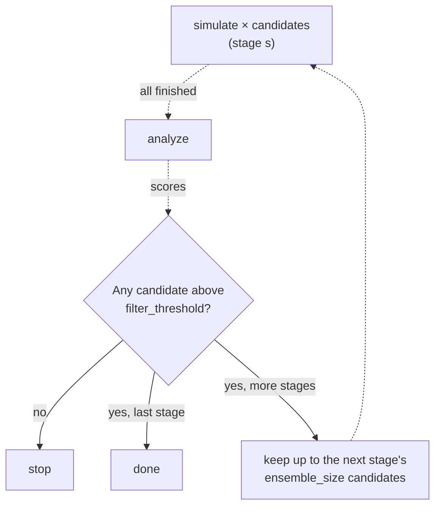
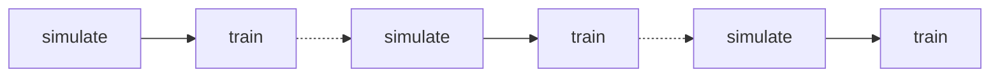
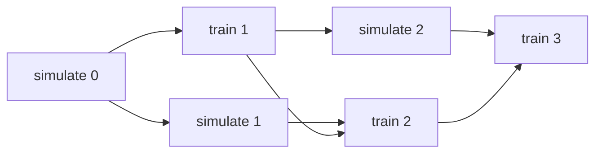
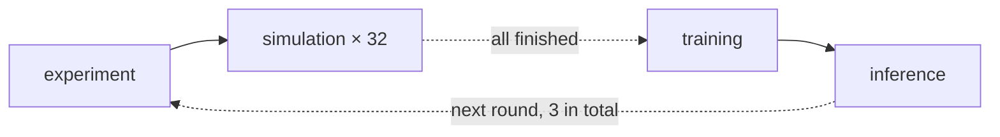
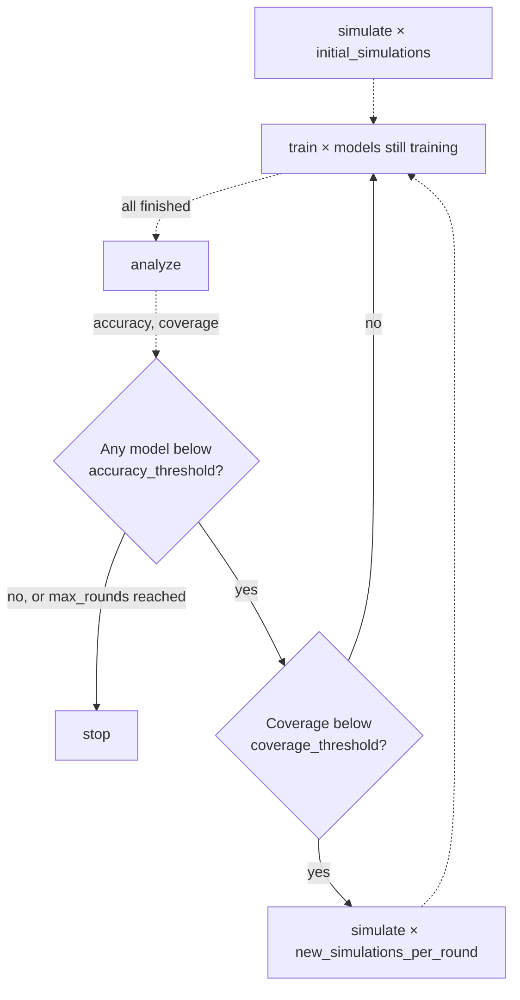
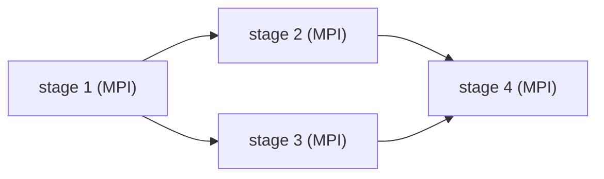

# Examples

This page describes the mini-apps in `examples/`: what each one emulates, its task
graph, and how to run it. Each example's README has the full setup for the node.

All of them use the [MiniApp script](api/miniapp.md#the-script), keep their sizes in
`config.yaml`, and run under Dragon with GPU kernels in some tasks; see
[Run on HPC](hpc.md). To try MiniApp on a laptop first, use the
[Quick start](getting-started.md#quick-start).

**Reading the graphs.** A solid arrow is a dependency: the engine starts the second task
when the first one finishes. A dashed arrow is a wait in the workflow: the workflow
awaits the first tasks, then creates the next ones, often based on their results.

| Example | Emulates | Tasks per run |
|---|---|---|
| [motif_2](#motif_2-multistage-pipeline) | a multistage screening pipeline | varies |
| [motif_3](#motif_3-inverse-design) | inverse design | 6 |
| [motif_4](#motif_4-digital-replica) | a digital replica | 105 |
| [motif_6](#motif_6-adaptive-training) | adaptive training (hyperparameter search) | varies |
| [dragon-mpi](#dragon-mpi-mpi-tasks) | a pipeline of MPI tasks | 4 |

## motif_2: multistage pipeline

`examples/motif_2/miniapp_pipeline.py`, scope `motif_2`. A sequence of simulation stages,
in the style of a high-throughput virtual screening pipeline. After each stage, an
analysis task scores the candidates, and only those above the stage's
`filter_threshold` go on to the next, smaller stage. The scores are random, so the
number of tasks varies from run to run.



```shell
cd examples/motif_2 && dragon -s miniapp_pipeline.py
```

!!! warning "Needs an input file in a fresh directory"
    Every `simulate` task reads `./data_0.h5` before writing it, so in a directory
    without that file the first stage fails. Create one before the first run:

        python -c "from wfMiniAPI import kernel as k; k.writeNonMPI(1048576, './')"

## motif_3: inverse design

Two variants of an inverse-design loop, each with three `simulate` and three `train`
tasks.

**`miniapp_simple.py`** (scope `motif_3_simple`): three rounds of simulate, then train.



**`miniapp_parallel.py`** (scope `motif_3_parallel`): the same six tasks, overlapped
through dependencies only.



```shell
cd examples/motif_3 && dragon -s miniapp_simple.py     # or miniapp_parallel.py
```

## motif_4: digital replica

`examples/motif_4/miniapp_async.py`, scope `motif_4`. Three rounds: an experiment
produces data, 32 simulations use it, then a model is trained and used for inference.
Each round has 35 tasks; the run has 105.



```shell
cd examples/motif_4 && dragon -s miniapp_async.py
```

## motif_6: adaptive training

`examples/motif_6/miniapp_adaptive.py`, scope `motif_6`. Training as a workflow of its
own, in the style of a hyperparameter search. Simulations produce training data, then an
ensemble of models is trained in rounds. After each round, an analysis task scores the
models and the data: models below `accuracy_threshold` are retrained with new
hyperparameters, and new simulations run when the data coverage is too low. The run
stops when every model passes or after `max_rounds`. The scores are random, so the
number of tasks varies from run to run.



```shell
cd examples/motif_6 && dragon -s miniapp_adaptive.py
```

## dragon-mpi: MPI tasks

`examples/dragon-mpi/miniapp_rhapsody.py`, scope `dragon_mpi`. Four MPI tasks in a
diamond; each one runs with the number of ranks set in `config.yaml` and does MPI file
I/O. Before the first task, the workflow writes a small input file.



```shell
cd examples/dragon-mpi && dragon miniapp_rhapsody.py
```

This example needs an MPI library and `h5py` built with MPI support on the node; see
its README.

## Other directories

- `examples/tutorial/`: three standalone task scripts (`simulation.py`, `training.py`,
  `active_learn.py`) that call the kernels directly, without a workflow engine.
- `examples/legacy/`: older mini-apps written for a previous RADICAL API, kept for
  reference and no longer maintained.
