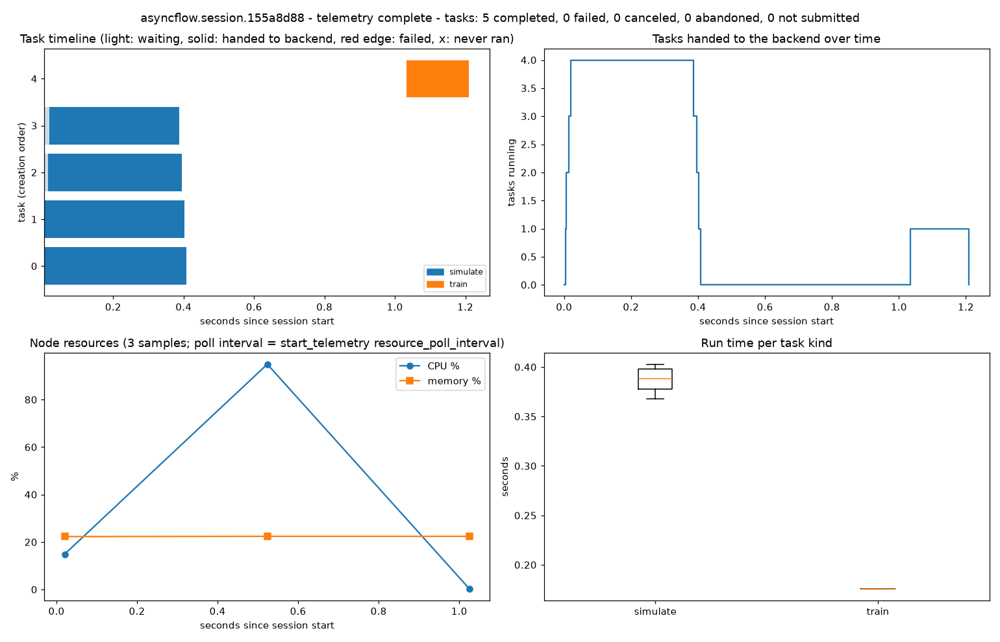

# Getting started

This page installs wfMiniAPI and runs a first mini-app on a laptop, with `MiniApp`
recording the run. This takes about five minutes.

## Install

wfMiniAPI needs Python 3.12 or newer.

```shell
git clone https://github.com/radical-cybertools/workflow-mini-apps.git
cd workflow-mini-apps
pip install -e ".[workflow]"
```

`workflow` is all the Quick start needs. Add other extras as you need them:

| Extra | Installs | Needed for |
|---|---|---|
| `workflow` | AsyncFlow and RHAPSODY, with telemetry | `MiniApp` and every example |
| `io` | `h5py` | the I/O kernels |
| `mpi` | `mpi4py` | the I/O and communication kernels |
| `gpu` | `cupy-cuda12x` | running kernels on an NVIDIA GPU (for AMD, see [Run on HPC](hpc.md#install)) |
| `dragon` | the Dragon backend, through RHAPSODY | the examples; see [Run on HPC](hpc.md) |
| `plot` | `matplotlib` | `tools/plot_run.py` |
| `test`, `docs`, `dev` | pytest; MkDocs; ruff and pre-commit | working on wfMiniAPI itself |

`mpi4py` needs an MPI library on the machine (for example `apt install libopenmpi-dev`,
a site module, or `pip install mpich`).

## Quick start

A mini-app is a workflow whose tasks call emulation kernels instead of running the real
application. This one has four `simulate` tasks and one `train` task that runs after
them, all on the CPU. Save it as `quickstart.py`:

```python
import asyncio

from radical.asyncflow import WorkflowEngine
from rhapsody.backends import ConcurrentExecutionBackend

from wfMiniAPI import kernel as wf
from wfMiniAPI.api import MiniApp


async def workflow(flow):
    @flow.function_task
    async def simulate(i):
        for _ in range(10):
            wf.matMulSimple2D("cpu", 1024)  # stands in for one simulation step
        return i

    @flow.function_task
    async def train(*simulations):
        for _ in range(20):
            wf.matMulSimple2D("cpu", 1024)  # stands in for a training step
        return len(simulations)

    sims = [simulate(i) for i in range(4)]
    await train(*sims)                      # runs after all four simulations


async def main():
    backend = await ConcurrentExecutionBackend()
    flow = await WorkflowEngine.create(backend=backend)
    telemetry = await flow.start_telemetry(checkpoint_path="telemetry", resource_poll_interval=0.5)
    app = MiniApp(flow, telemetry)
    try:
        async with app, flow.workflow_scope("quickstart"):
            await workflow(flow)
    finally:
        try:
            await flow.shutdown()
        finally:
            await telemetry.stop()
            app.verify()
    print(app.report.telemetry_complete, app.report.tasks)


asyncio.run(main())
```

Run it:

```shell
python quickstart.py
```

```text
True TaskCounts(created=5, completed=5, failed=0, canceled=0, abandoned=0, not_submitted=0)
```

`True` means the run's record is complete: every event reached the checkpoint. All
five tasks completed. On a machine without an NVIDIA GPU, RHAPSODY also prints a line
saying that GPU metrics are disabled.

What each part does:

- `workflow()` is the mini-app: the kernels stand in for the application's work, and
  passing the `simulate` results to `train` makes `train` wait for them. How to design
  one is in [Write the workflow](building.md).
- `main()` is the script every mini-app shares: it builds the engine and telemetry, runs
  the workflow inside the `MiniApp` block, and shuts everything down. The shape is
  explained in [Use MiniApp](api/miniapp.md).

## See the run

The run left two files in `telemetry/`: the checkpoint (`*.telemetry.jsonl`) and
`MiniApp`'s report (`*.wfminiapi.report.json`). [Telemetry](telemetry.md) explains
both. To plot the run:

```shell
pip install -e ".[plot]"
python tools/plot_run.py telemetry/ run.png
```



The four `simulate` tasks run in parallel; `train` starts once all four have finished
and the engine has scheduled it.

## Next steps

- [Write the workflow](building.md): turn an application into a mini-app.
- [Examples](examples.md): the mini-apps in this repository. They run on HPC with the
  Dragon backend; see [Run on HPC](hpc.md).
- [Kernels](kernels.md): every kernel and what it stands in for.
