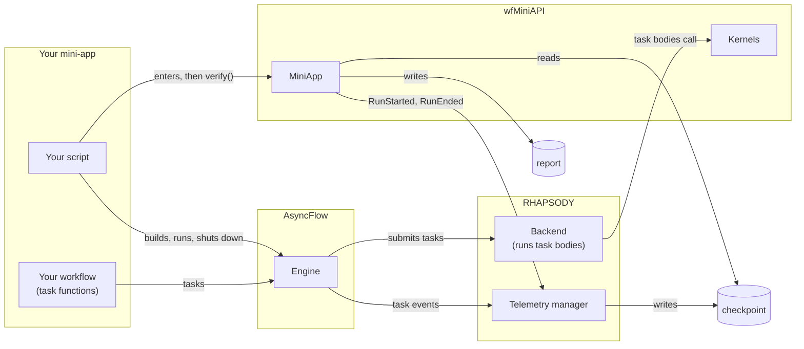

# RADICAL Workflow Mini-Apps

wfMiniAPI is a library for building **workflow mini-apps**: small, self-contained
versions of scientific workflows that keep the shape and the load of the real thing
without its code, data or deployment. Its `MiniApp` records every run of a mini-app
and checks that the record is complete.

## What wfMiniAPI gives you

- **Kernels** that stand in for an application's work inside tasks: computation, file
  I/O, MPI communication and host/GPU data movement, on CPU or GPU.
  See [Kernels](kernels.md).
- **`MiniApp`**, which attaches to a run, records when it started and how it ended, and
  afterwards verifies that the run's telemetry reached its file, in a short report.
  See [Use MiniApp](api/miniapp.md) and [Telemetry](telemetry.md).
- **Example mini-apps** of common workflow patterns: pipelines, inverse design, digital
  replicas, adaptive training and MPI tasks. See [Examples](examples.md).

## A mini-app run

Your script builds the engine and the telemetry, runs your workflow, and shuts them
down. `MiniApp` sits beside the run: it never runs or stops anything, it only records
the run and checks the result.

!!! info "Built on AsyncFlow and RHAPSODY"
    The workflow engine is [AsyncFlow](https://radical-cybertools.github.io/radical.asyncflow/):
    it runs your tasks in dependency order. The execution backends and the telemetry
    come from [RHAPSODY](https://radical-cybertools.github.io/rhapsody/). These docs
    cover only what wfMiniAPI adds, and link to theirs for the rest.

## Where to go next

| To | Read |
|---|---|
| install wfMiniAPI and run a first mini-app on a laptop | [Getting started](getting-started.md) |
| turn an application into a mini-app | [Write the workflow](building.md) |
| attach `MiniApp` to your script | [Use MiniApp](api/miniapp.md) |
| understand and read what a run records | [Telemetry](telemetry.md) |
| run on an HPC allocation | [Run on HPC](hpc.md) |
| fix an error or an incomplete report | [Troubleshooting](troubleshooting.md) |

The AI-steered simulation mini-app lives in its own repository,
[DeepDriveSim](https://github.com/radical-collaboration/DeepDriveSim).
