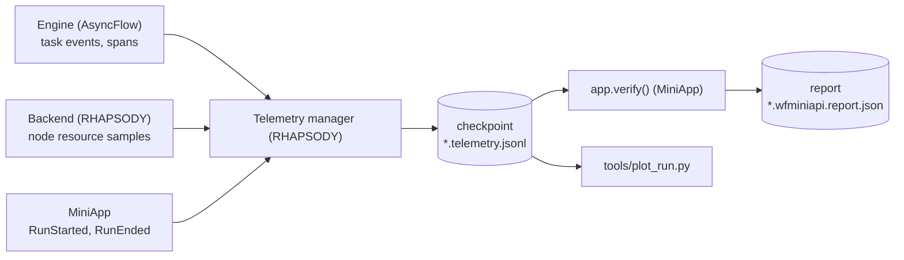
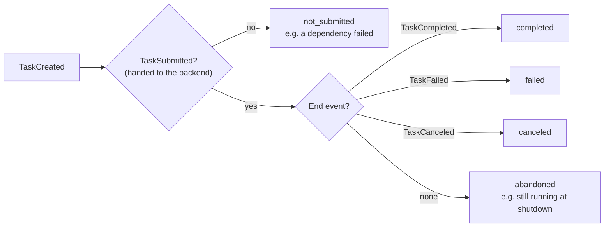

# Telemetry

This page explains what a mini-app run records, what the `MiniApp` report tells you,
and how to read the data afterwards.

Every run that uses [MiniApp](api/miniapp.md) leaves two files in the
`checkpoint_path` directory: the **checkpoint**, a timestamped record of the whole run,
and the **report**, `MiniApp`'s verdict on whether that record is complete.

## Where the data comes from

Your script starts telemetry with `flow.start_telemetry(checkpoint_path=...)`. That
call creates a RHAPSODY telemetry manager, which collects events from the engine, the
backend and `MiniApp`, and writes them to the checkpoint. `MiniApp` adds a few events of
its own, and after the run it reads the checkpoint and writes the report.



## The files

| File | What it holds |
|---|---|
| `<session>.<number>.telemetry.jsonl` | The **checkpoint**: one JSON object per line. Each line has a `section`: `event`, `metric` or `span`. `<session>` is the engine's id, for example `asyncflow.session.155a8d88`. |
| `<session>.wfminiapi.report.json` | The **report** written by `app.verify()` (below). |

## What the checkpoint holds

| Recorded | By | Details |
|---|---|---|
| Each task's lifecycle: created, queued, handed to the backend, completed, failed or cancelled, with its function name and workflow scope | AsyncFlow | [AsyncFlow telemetry](https://radical-cybertools.github.io/radical.asyncflow/telemetry/) |
| Node resources sampled while the run goes: CPU, memory, GPU, disk and network | RHAPSODY | [RHAPSODY events and metrics](https://radical-cybertools.github.io/rhapsody/telemetry/reference/) |
| Counters and task durations, written when telemetry stops | RHAPSODY | [RHAPSODY events and metrics](https://radical-cybertools.github.io/rhapsody/telemetry/reference/) |
| Trace spans: session → workflow scope → task | AsyncFlow and RHAPSODY | [AsyncFlow telemetry](https://radical-cybertools.github.io/radical.asyncflow/telemetry/) |
| The run itself: when it started, how it ended, the versions used | `MiniApp` | [MiniApp's events](#miniapps-events), below |

## MiniApp's events

`MiniApp` adds four events to the checkpoint. Their `event_type` starts with
`wfminiapi.`, their `backend` is `wfminiapi`, and their `schema` is `wfminiapi/1`.

| Event | When | Fields |
|---|---|---|
| `wfminiapi.RunStarted` | the `MiniApp` block starts | `wfminiapi_version`, `asyncflow_version`, `rhapsody_version` (each with its git commit when known), `backends` (class names), `run_id` (the run engine's session id), `part` (this engine's part name in a run of many engines, else empty) |
| `wfminiapi.Parameters` | `app.parameters(...)` is called, or the block is entered after it | `parameters`: the run's configuration, as JSON |
| `wfminiapi.Barrier` | the `MiniApp` block starts, just before `RunStarted` | `purpose`. A marker: `MiniApp` waits until telemetry has processed it, which shows telemetry is running. |
| `wfminiapi.RunEnded` | the `MiniApp` block ends | `ended_by` ([how it is decided](api/miniapp.md#how-ended_by-is-decided)), `exception_type` (empty unless the block raised), `duration_s` (the block's duration, without the shutdown) |

A real `RunStarted` line:

```json
{"event_type": "wfminiapi.RunStarted", "session_id": "asyncflow.session.155a8d88",
 "backend": "wfminiapi", "schema": "wfminiapi/1", "wfminiapi_version": "0.2.0@431656e",
 "asyncflow_version": "0.7.0@3f18cc8", "rhapsody_version": "0.6.0@142f396",
 "backends": "ConcurrentExecutionBackend", "section": "event", "...": "..."}
```

## The report

`app.verify()` sets `app.report` and writes the same content to
`<session>.wfminiapi.report.json`:

| Field | Meaning |
|---|---|
| `session_id` | The engine's id; also the start of the checkpoint's file name. |
| `checkpoint` | The checkpoint file that was read, or `null` if none was. |
| `telemetry_complete` | `true` if the record has no gap (see below). |
| `ended_by` | How the `MiniApp` block ended: `normal`, `exception`, `cancelled` or `engine_shutdown` ([how it is decided](api/miniapp.md#how-ended_by-is-decided)). |
| `tasks` | How many tasks ended which way (see the diagram below). AsyncFlow blocks (`@flow.block`) are not counted. |
| `events` | `MiniApp`'s own events found in the checkpoint, by type. |
| `reasons` | Why the record is incomplete. Empty when `telemetry_complete` is `true`. |
| `notes` | Facts worth knowing that do not make the record incomplete. |
| `run_id`, `part` | The run this engine belongs to, and its part name (empty for the run's own engine). |
| `parameters` | The run's configuration, from `app.parameters(...)`. |
| `completed_by_executable` | Completed tasks, by function name. |
| `parts`, `components`, `checks`, `checks_pass` | For a run of many engines and components; see [Runs of many engines](runs.md). |
| `exit_hint` | `0` if complete and every check passes, `3` if the record is incomplete, `4` if it is complete but a check failed. wfMiniAPI never exits by itself; a script may end with `sys.exit(app.report.exit_hint)`. |

The report of the [Quick start](getting-started.md#quick-start) run:

```json
{
 "session_id": "asyncflow.session.155a8d88",
 "checkpoint": "telemetry/asyncflow.session.155a8d88.1795476541.telemetry.jsonl",
 "telemetry_complete": true,
 "ended_by": "normal",
 "tasks": {"created": 5, "completed": 5, "failed": 0, "canceled": 0,
           "abandoned": 0, "not_submitted": 0},
 "events": {"wfminiapi.Barrier": 1, "wfminiapi.RunEnded": 1, "wfminiapi.RunStarted": 1},
 "reasons": [],
 "notes": [],
 "exit_hint": 0
}
```

### How tasks are counted

`MiniApp` sorts every task by the events the checkpoint holds for it:



`failed` counts only the tasks whose failure the backend reported. A task whose
dependency failed is never handed to the backend, so it counts as `not_submitted`.

### When the record is complete

`telemetry_complete` is `true` when all of the following hold:

- the directory holds exactly one checkpoint for this session;
- every event `MiniApp` sent, and every task event `MiniApp` saw during the run, is in
  the file;
- telemetry finished writing its queue when it stopped;
- telemetry was still running when the `MiniApp` block ended, or was stopped by the
  engine's shutdown, not by hand while the engine still ran.

An incomplete record does not mean the workflow failed: it means the record has a gap.
`reasons` says which one; [Troubleshooting](troubleshooting.md#the-report-says-incomplete)
explains each reason and what to do.

## Settings

`flow.start_telemetry()` takes these options. Only `checkpoint_path` matters to
`MiniApp`; the others change what is recorded.

| Option | Default | Effect |
|---|---|---|
| `checkpoint_path` | none | Directory for the checkpoint. **Required by `MiniApp`**: without a file there is nothing to verify. Give each run its own directory. |
| `resource_poll_interval` | `5.0` | Seconds between node resource samples. Lower it (for example `0.5`) for short runs. |
| `checkpoint_interval` | none | Seconds between periodic writes of metrics and spans. By default they are written once, when telemetry stops. |

Sending spans and metrics to an external system (Jaeger, Prometheus, Grafana) is
configured through the same call; see
[RHAPSODY telemetry](https://radical-cybertools.github.io/rhapsody/telemetry/).

## Reading the data

**Plot a run.** `tools/plot_run.py` draws the task timeline, the tasks on the backend
over time, node CPU and memory, and run time per task kind (it needs the `plot` extra):

```shell
python tools/plot_run.py telemetry/ run.png
```

The directory must hold one run. The plot of the Quick start run is on
[Getting started](getting-started.md#see-the-run).

**In Python**, for example the mean run time of each task function:

```python
import collections, glob, json

(path,) = glob.glob("telemetry/*.telemetry.jsonl")
times = collections.defaultdict(list)
for line in open(path):
    rec = json.loads(line)
    if rec.get("section") == "event" and rec["event_type"] == "TaskCompleted":
        times[rec["attributes"]["executable"]].append(rec["duration_seconds"])
for name, values in times.items():
    print(f"{name}: {len(values)} tasks, mean {sum(values) / len(values):.2f} s")
```

**With `jq`**, for example the failed tasks and their functions:

```shell
jq -c 'select(.event_type == "TaskFailed") | {task_id, executable: .attributes.executable}' telemetry/*.telemetry.jsonl
```

**While the run goes**, `telemetry.subscribe(callback)` calls `callback(event)` for
every event; see
[AsyncFlow telemetry](https://radical-cybertools.github.io/radical.asyncflow/telemetry/).

## Limits

| What | Effect |
|---|---|
| Nothing inside a task is recorded | Telemetry records tasks, not the kernels or steps inside them. To time a kernel, use `time_kernel()` ([Kernels](kernels.md#calling-a-kernel-by-name)) or your own timers in the task. |
| A task "starts" when the backend accepts it | `TaskStarted` marks the hand-over to the backend, not the moment the task body starts, so waiting in the backend and running are not separated. |
| Tasks still running at shutdown have no end event | After Ctrl-C or an error, the report counts them as `abandoned`. |
| The error class of a failed task is not recorded | `TaskFailed` carries `error_type` = `unknown`; the error itself is in the run's output. |
| Metrics are a final snapshot | Without `checkpoint_interval`, counters are written once, at the end. Events and spans carry the timeline. |
| Resource samples depend on the backend | GPU values appear only on nodes with a GPU the backend can see. On single-node Dragon runs, disk and network values were `0.0`. |
| Warnings are hidden under the `dragon` launcher | See [Run on HPC](hpc.md#logging). The report file is not affected. |
